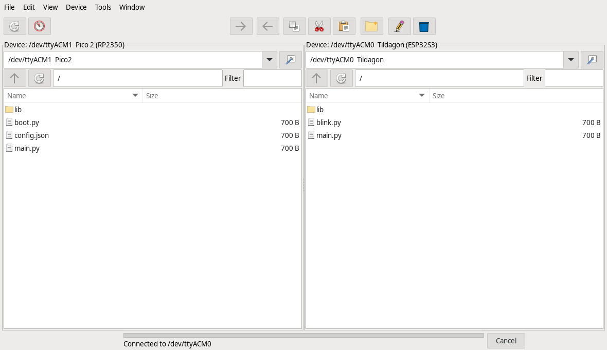
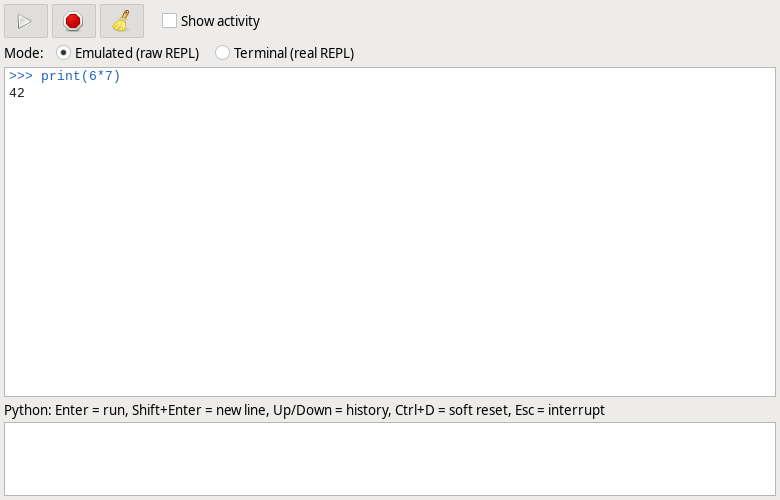
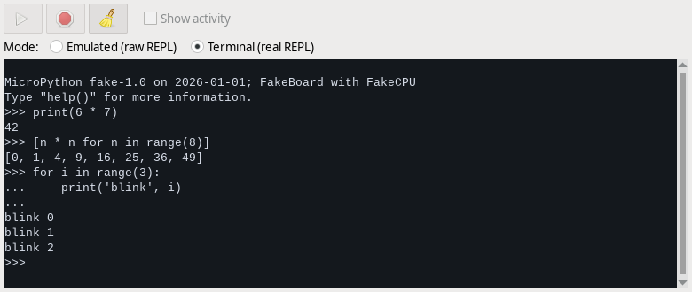

# mpexplorer

[](https://github.com/Corteil/mpexplorer/actions/workflows/ci.yml)

A dual-pane file explorer with a GUI for MicroPython boards (Raspberry Pi Pico / Pico 2, EMF Camp badges from 2022 (TiLDA Mk6), 2024
(Tildagon) and 2026, anything that runs MicroPython). It runs on a **Raspberry Pi 5** (or any computer with Python 3 and GTK 3) and talks to the
board over USB serial. **Nothing is installed on the board** in normal use: it works through the stock raw REPL, like `mpremote`.







## Features
- Two panes, each showing the host or a board, so two boards can be open side by side: browse, sort, filter, show hidden files
- **Firmware badges and nicknames:** every board in the port list carries a **CP** (CircuitPython) or **MP** (MicroPython) badge, the
  pane label names the firmware and version, and *Device > Name this board* (or the bookmark button by the port box) gives a board a
  nickname that follows it by chip id, kept on this computer only
- **CircuitPython boards** work too: files go through the mounted `CIRCUITPY` drive, and Run, the REPL console and the terminal go over
  serial. *Open with* edits a file on the drive in place
- **Install libraries** (Tools menu): micropython-lib for MicroPython, the Adafruit and Community bundles for CircuitPython, fetched on the
  Pi and written to `/lib` (the board needs no network). *Check for updates* compares each installed library with its source, and the
  Show filter and *Select installed* act on the result. **Custom sources** (Preferences > Sources, or *Manage sources...* in the dialog)
  add a maker's bundle repo (SparkFun Qwiic), a `package.json` repo (Pimoroni `phew`), a micropython-lib style index, or a folder or
  .zip of your own libraries
- **Badge apps** (Tools menu): the EMF badge app store for Tildagon OS badges (2024 and 2026). Browse and search its apps by
  category, see what is on the badge and what has an update, and install, update or remove them over USB (the badge needs no
  Wi-Fi), or install one by its code. *Download for offline* keeps the whole store (about 12 MB) in a folder on this computer,
  so apps can be installed with no internet at all; *Store folder...* puts that folder anywhere, such as a USB stick to copy
  to another computer. Star your **favourites** and *Install all favourites* puts every one of them on a badge, which makes
  setting up several badges the same way quick. *Restart the badge* lets its menu see the new apps
- **Custom firmware sources** (Tools > Install firmware > *Manage sources...*): a maker's GitHub releases (presets for Pimoroni MicroPython,
  RP2350 and Pico LiPo) or a direct HTTPS link. A source is checked before it is saved, a site that is not GitHub is trusted only after
  you say so, and the chip check still refuses a wrong image before anything is written
- *Device > Board memory...* shows a connected board's flash chip, file system and RAM
- Copy files and folders between the panes (buttons, drag, or copy and paste). Dragging onto a folder copies into it, or moves
  into it within one pane
- Copy, cut, paste, rename, delete, new file / folder, properties, free space
- Copy from a board, disconnect it, and paste on another: the files are downloaded as you disconnect, so a large copy takes
  time then. A cut becomes a copy, because the first board has gone
- **Install firmware, back up or restore the flash, and erase it** (Tools menu), for boards in their bootloader. Firmware comes from
  micropython.org or the EMF flashers, or a file. A running Pico or Tildagon can be sent to its bootloader with a button
- Conflict handling (overwrite / skip / keep both / apply to all), progress, speed and cancel
- **REPL console** (Device > REPL console, one per board), emulated mode: run Python on the board, output streams as it arrives.
  `_` holds the last result, Ctrl+D soft-resets, Esc interrupts, Up/Down is history, Shift+Enter adds a line.
  `input()` works: while a program runs, Enter sends your line to it. **Show activity** displays every snippet
  sent to the board and every reply (file operations included), which is handy for debugging. While a command
  runs, other device operations wait. 
  **Terminal mode** (the radio button at the top of the console) is the board's real REPL: keystrokes go straight
  to it, so you get its own tab completion, history, auto-indent, paste mode (multi-line paste is wrapped
  automatically), Ctrl+C/D/E/B, `_` and `input()`. Copy and paste with Ctrl+Shift+C / Ctrl+Shift+V. While the
  terminal is active the device pane is paused (the serial line has one user at a time); switch back and your
  variables are still there.
  **Open in external terminal...** (in the console and the Device menu) gives the port to another program instead:
  miniterm by default, or PuTTY, Tera Term, picocom or your own command (Preferences > Terminal). mpexplorer disconnects
  while it is open and reconnects when it closes, even if the board comes back on another port. On a system without
  VTE (Windows) this is the console's only terminal, and the Mode buttons are not shown.
- **Folder sync** (Tools > Sync folders): compares by size and SHA-256 (computed on the
  device, so nothing is transferred to check), shows a preview, copies only what changed, optional mirror-delete.
  `__pycache__`, `.git`, `*.pyc` are skipped. Files are written under a temporary name so a cancel never loses
  the old copy.
- Built-in text editor that saves straight back to the board; run a script and see its output; soft reset
- **Choose the program that opens a file:** double-click or Enter opens a file with the program saved for its extension, or the
  built-in editor if none is saved. Right-click > **Open with...** (Shift+Enter) lists the built-in editor, *Run on the board*
  (for `.py` files), the hex and image viewers, every desktop app installed for that file type, and a **Custom command** such as
  `geany {file}`. Tick *Always use this for .ext files* to make it the default; change or remove defaults in
  **Edit > Preferences > File types**. Files on the host open directly. A file on a board is downloaded to a private cache,
  opened in the program, and each save is uploaded back (if the board's copy changed meanwhile you choose overwrite, keep both or
  skip). The status bar's *Pause* button holds uploads, and Preferences can turn automatic upload off

## Install (Raspberry Pi OS)
```
sudo apt install python3-gi gir1.2-gtk-3.0 gir1.2-vte-2.91 pipx
sudo usermod -aG dialout $USER      # serial access; log out and in again
pipx install --system-site-packages git+https://github.com/Corteil/mpexplorer@v0.3.0
mpexplorer --install-desktop      # optional: menu entry and desktop icon
mpexplorer
```
Drop the `@v0.3.0` to follow the development version on `main`. `mpexplorer --version` prints the installed version, and
[CHANGELOG.md](CHANGELOG.md) lists what changed.
Plug the board in, press **Scan**, choose it in a pane's list, and press that pane's **Connect**.

The Tools menu can install firmware, back up or restore the flash, and erase it. A badge or other ESP32-S3 needs
`pipx install esptool`; a Pico or Pico 2 needs nothing extra.

The interface is GTK 3 through PyGObject (`python3-gi`, already on Raspberry Pi OS); `--system-site-packages` lets
pipx see it. `gir1.2-vte-2.91` is only needed for the console's Terminal mode.

For a menu entry, desktop icon and taskbar icon, run `mpexplorer --install-desktop` once after installing
(`--uninstall-desktop` removes them). It writes the launcher and icon into `~/.local/share` and a copy onto the desktop;
no root is needed. From a checkout, `sh packaging/install-launcher.sh` does the same. The window reports the app id
`mpexplorer`, which is how the taskbar finds them.

## Windows (preview)
A portable build for Windows 10 and 11 comes with each release from 0.2.0: download `mpexplorer-<version>-windows.zip`
from the [releases page](https://github.com/Corteil/mpexplorer/releases), unzip it anywhere and run
`mpexplorer\mpexplorer.exe`. (The newest build of `main` is the `mpexplorer-windows` artifact of the **Windows build**
workflow in the Actions tab; downloading it needs a GitHub account.) Nothing needs installing: GTK, Python, pyserial,
miniterm and esptool are inside. Settings go to `%APPDATA%\mpexplorer`; create a file named `portable.txt` beside the
exe (rename `portable.txt.example`) to keep them in a `data` folder there instead, for a USB stick.
The build is **not signed yet**, so Windows SmartScreen says "Windows protected your PC" on the first run: choose
*More info*, then *Run anyway*. The console has the emulated REPL and **Open in external terminal...** (there is no
built-in terminal on Windows). Tried by hand on Windows 11 with a Tildagon (browsing, the external terminal, Open with
on a file on the badge); the rest is covered by the tests only so far: see `docs/WINDOWS_PLAN.md`.

## Development
```
pip install -e '.[dev]'
ruff check . && pytest
```
Tests use a fake board that speaks the raw REPL, so no hardware is needed. See [docs/DESIGN.md](docs/DESIGN.md).

## Status
The core and the GTK interface are written, and the tests (fake board, real MicroPython, GTK windows under a virtual display)
run in CI. See [CHANGELOG.md](CHANGELOG.md).

**Tested by hand on a Raspberry Pi 5**, with these boards: Tildagon (2024/2026), 2022 TiLDA Mk6 badge, Pico, Pico 2 and Pico W
(CircuitPython only on a Pico 2). **Not tested on real hardware:** other ESP32-S3 boards, and two boards at once beyond a
Pico 2 and a Pico W copy. Details, and what exactly was checked, are in [docs/HANDOFF.md](docs/HANDOFF.md) and
[docs/HARDWARE.md](docs/HARDWARE.md); please add your board.

Security notes, including the warning that flash backups can contain Wi-Fi passwords: [SECURITY.md](SECURITY.md).
